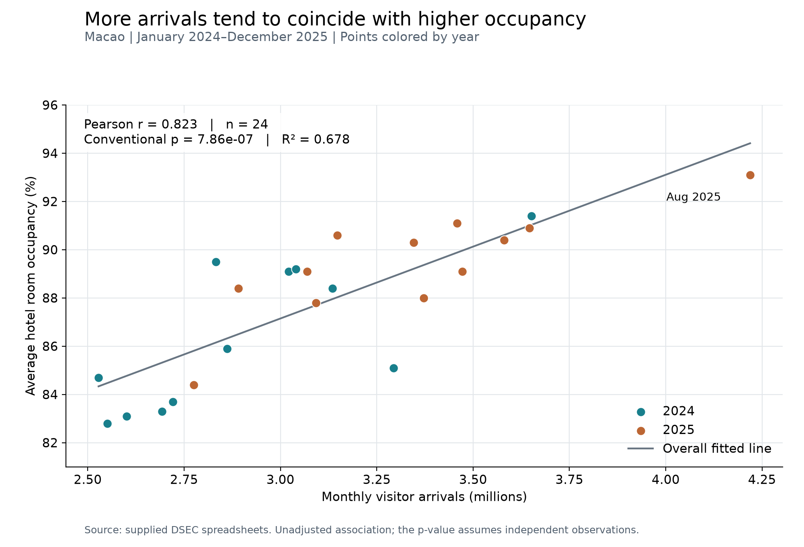

# Xie Ziqi — Data Science Portfolio
## About Me
I am developing skills in Python, data analysis, and visualization.
My projects focus on turning real‑world public‑dataset research questions into clear,
reproducible analyses for tourism‑related social topics.

## Technical Skills
- Python and pandas
- Data cleaning and exploratory time‑series data analysis
- SciPy statistical correlation calculation
- Matplotlib and data visualization
- GitHub and project documentation for reproducible work

## Featured Project: Monthly Visitor Arrivals and Hotel Room Occupancy in Macao, 2024‑2025
### Research Question
Is there a statistically significant positive association between monthly visitor arrivals and the average hotel room occupancy rate in Macao from January 2024 to December 2025? Do months with more arrivals tend to have higher occupancy?

### Approach
I inspected two official DSEC tourism datasets, filtered and merged monthly records for 24‑month observations. I calculated descriptive statistics and Pearson correlation coefficient, and built visualizations to explore the relationship between visitor volume and hotel occupancy rate.

### Visualization

### Findings
There is a strong statistically significant positive association between monthly visitor arrivals and hotel room occupancy (Pearson r = 0.823, p < 0.001). Higher‑arrival months generally correspond to higher occupancy. Both indicators reached their peak value in August 2025, although they do not move in the same direction for every single month.The r‑value of 0.823 indicates strong positive linear correlation between the two tourism metrics.

### Limitation
These results describe correlation rather than causation. The analysis does not control for confounding factors such as seasonality, special local events and same‑day visitor proportion, and monthly time‑series observations may be autocorrelated.

### Project Repository
[View the code and README](https://github.com/Kiya-0724/data-science-project)

### Status
Completed
